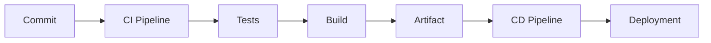

# App Basic

Aplicación básica diseñada exclusivamente para practicar, validar y demostrar procesos de Integración Continua (CI) y Despliegue Continuo (CD).

## Objetivo

Este proyecto proporciona una aplicación mínima sobre la que se pueden construir y probar diferentes estrategias de automatización relacionadas con:

- Continuous Integration (CI)
- Continuous Delivery (CD)
- Continuous Deployment
- Quality Gates
- Testing Automation
- Containerización con Docker
- GitHub Actions
- Azure DevOps Pipelines
- Despliegues en entornos Cloud

La lógica de negocio de la aplicación no es el foco principal. El objetivo es disponer de una base simple y estable para experimentar con flujos DevOps.

## Casos de uso

Este repositorio puede utilizarse para:

- Ejecutar pruebas automáticas en cada cambio.
- Validar estándares de calidad de código.
- Construir artefactos de forma automatizada.
- Generar imágenes Docker.
- Publicar versiones.
- Automatizar despliegues hacia entornos de desarrollo, pruebas o producción.
- Implementar estrategias GitFlow o Trunk-Based Development.

## Estructura del proyecto

```text
app_basic/
├── src/
├── tests/
├── .github/
│   └── workflows/
├── Dockerfile
└── README.md
```

> La estructura puede evolucionar según los ejercicios o desafíos CI/CD implementados.

## Flujo esperado



## Tecnologías

- Git
- GitHub
- GitHub Actions
- Docker
- DevOps Practices

## Propósito educativo

Este repositorio forma parte de una serie de laboratorios y desafíos prácticos orientados a fortalecer habilidades de:

- DevOps
- CI/CD
- Automatización
- Observabilidad
- Cloud Engineering
- Platform Engineering

## Licencia

Proyecto utilizado con fines educativos, demostrativos y de experimentación técnica.

## Autor
- Renzo Medina | DevOps & Desarrollador LMS